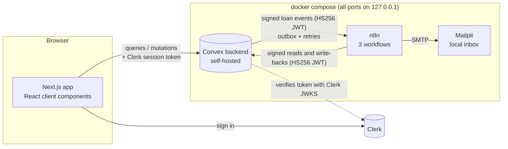
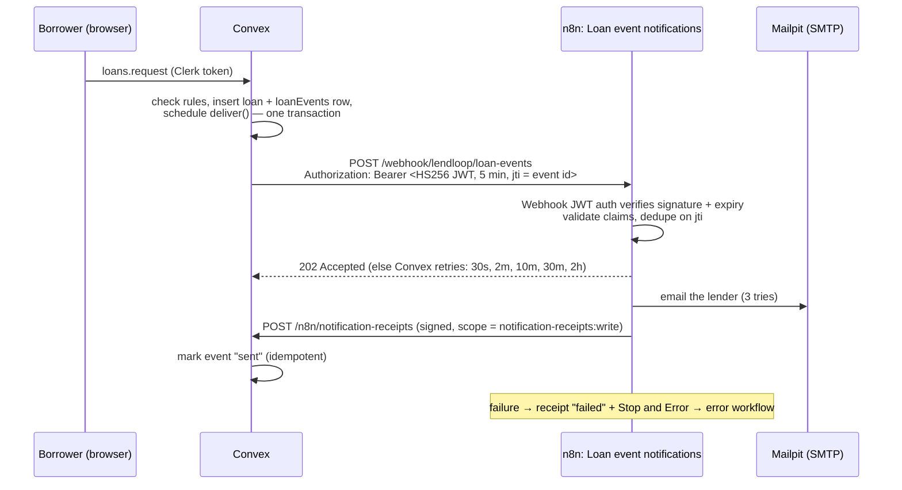

# LendLoop

**Borrow what you need. Lend what you don't.**

LendLoop is a neighbourhood tool-lending board. Neighbours list tools they're happy to lend, request to borrow
each other's tools for a date range, and get email notifications and overdue reminders sent by n8n.

Built with **Next.js 16 (App Router, TypeScript)**, **Clerk** for authentication, **Convex** for data and backend
logic, and **n8n** for the automation, all running locally with one setup command.

- [What it does](#what-it-does)
- [Architecture](#architecture)
- [Local setup](#local-setup)
- [Environment variables](#environment-variables)
- [The n8n workflows](#the-n8n-workflows)
- [Security decisions](#security-decisions)
- [Data minimization](#data-minimization)
- [Tests](#tests)
- [Running it in production](#running-it-in-production)
- [Project layout](#project-layout)

## What it does

**Public page** (`/`): the LendLoop name and tagline, a read-only list of tools that are available today (name
and category only, no owner details) pulled live from Convex, and a **Sign in to lend or borrow** button wired
to Clerk.

**Signed in:**

| Page                              | What you can do                                                                                                                                                                               |
| --------------------------------- | --------------------------------------------------------------------------------------------------------------------------------------------------------------------------------------------- |
| **Browse** (`/tools`)             | Every listed tool with its availability (available, booked from a date, on loan until a date, or overdue), filterable by category. Request to borrow for a date range, with an optional note. |
| **My listings** (`/listings`)     | List a tool (name, category, condition, short description), edit it, or delete it.                                                                                                            |
| **My requests** (`/requests`)     | Your borrow requests and loans, their status and automation activity. Cancel a request, or an approved loan that hasn't started yet.                                                          |
| **Incoming** (`/incoming`)        | Requests for your tools: approve or decline, then mark loans returned.                                                                                                                        |
| **Admin** (`/admin`, admins only) | Automation health, data protection (encryption coverage and a live check of the audit chain), every loan, Trusted Lender badges. Admins can also remove any listing from Browse.              |

Every loan shows its recent automation activity, for example _"Borrower emailed about the approval · 5 minutes
ago"_ or _"Overdue reminder sent to the borrower · 2 days ago"_.

**Roles.** `user` can create, edit and delete only their own listings, and act only on requests involving their
own tools or their own borrowing. `admin` can also remove any listing, view all loans and mark a lender as a
**Trusted Lender**. Every rule is enforced in the Convex functions; the UI only hides what you can't do.

**Loan rules** (all server-side): no borrowing your own tool; dates must be valid, start no earlier than
yesterday (UTC, so neighbours east of UTC aren't blocked), last at most 30 days and start within 180 days; one
open request per tool per borrower, at most 10 pending requests per borrower and 25 active listings per user;
approving a request is refused if it overlaps an approved loan, and overlapping pending requests are declined
automatically.

## Architecture



- **Next.js** renders a static shell for every page; data comes from Convex over a WebSocket, so lists update
  live. `proxy.ts` runs Clerk's middleware, redirects signed-out visitors away from app pages and sets a CSP.
- **Clerk** handles sign-in. Its Convex integration issues session tokens with `aud: "convex"`, and Convex
  verifies them against Clerk's public keys (`convex/auth.config.ts`).
- **Convex** holds all data and all rules: queries and mutations, a transactional outbox for loan events,
  HTTP endpoints for n8n, and a cron safety net.
- **n8n** sends the emails: a webhook workflow for loan events, a daily overdue-reminder workflow, and an error
  workflow. **Mailpit** is a local SMTP server with a web inbox, so every email is visible and nothing leaves
  your machine.

### Request notification (Convex → n8n)



The event is written in the same transaction as the loan change, so a rolled-back mutation never notifies anyone,
and a committed one always gets delivered or ends up visibly `failed` on the admin page (with a **Retry** button).

### Overdue reminders (n8n → Convex)

```mermaid
sequenceDiagram
  participant S as n8n: Overdue reminders
  participant C as Convex
  participant M as Mailpit (SMTP)
  Note over S: every day at 09:00 (Asia/Kolkata),<br/>or "Run overdue check now" on the admin page
  S->>C: POST /n8n/overdue-loans (signed, scope = overdue-loans:claim)
  C->>C: overdue loans with no reminder today:<br/>claim each for this run (30-min lease) + heartbeat
  C-->>S: claimed loans (borrower name + email, tool, due date)
  loop one loan at a time
    S->>M: email the borrower (3 tries)
    S->>C: POST /n8n/reminders {reminderKey = loanId:date, status} (signed)
    C->>C: upsert on reminderKey; "sent" is final
  end
  Note over S: any failed reminder → Stop and Error → error workflow
```

## Local setup

**Prerequisites:** Node.js 20.9+ and Docker with Compose (Docker Desktop, or Docker Engine with the compose
plugin; Colima and Lima work too). You need a free [Clerk](https://clerk.com) account. Convex and n8n run
self-hosted in Docker, so they need no accounts.

### 1. Clerk

1. Create an application in the [Clerk dashboard](https://dashboard.clerk.com) (email sign-in is enough).
2. Open **[Convex integration setup](https://dashboard.clerk.com/apps/setup/convex)** and click **Activate Convex
   integration**. Copy the **Frontend API URL** it shows (`https://<something>.clerk.accounts.dev`).
3. Go to **Sessions → Customize session token** and add these claims, so Convex gets a verified name and email
   (the `aud: "convex"` claim is already mapped by the integration):

   ```json
   {
     "name": "{{user.full_name}}",
     "given_name": "{{user.first_name}}",
     "family_name": "{{user.last_name}}",
     "email": "{{user.primary_email_address}}",
     "email_verified": "{{user.email_verified}}"
   }
   ```

4. Copy `.env.example` to `.env.local` and fill in `NEXT_PUBLIC_CLERK_PUBLISHABLE_KEY`, `CLERK_SECRET_KEY` (from
   **API keys**) and `CLERK_FRONTEND_API_URL`.
5. Optional: under **User & authentication**, ask for a first name at sign-up, so neighbours see "Asha K." rather
   than "Neighbour".

<details>
<summary>Prefer the terminal? The Clerk CLI does all of the above.</summary>

```bash
npx clerk@latest auth login              # opens the browser once
npx clerk@latest apps create "LendLoop" --json
# Use the application ID it prints (app_...):
npx clerk@latest env pull --app <app_id> --instance dev --print   # copy the two keys into .env.local
npx clerk@latest config patch --app <app_id> --instance dev --yes --json \
  '{"session":{"claims":{"aud":"convex","name":"{{user.full_name}}","given_name":"{{user.first_name}}","family_name":"{{user.last_name}}","email":"{{user.primary_email_address}}","email_verified":"{{user.email_verified}}"}},"user_model":{"first_name":{"enabled":true,"required":true},"last_name":{"enabled":true,"required":false}}}'
```

`CLERK_FRONTEND_API_URL` is `https://` plus the publishable key decoded (the part after `pk_test_` is base64 of the
Frontend API host, followed by `$`). The `aud: "convex"` session claim is what Clerk's Convex integration sets.

</details>

### 2. Everything else

```bash
npm install
npm run setup -- --seed
npm run dev
```

`npm run setup` is safe to re-run. It:

1. generates `.env.automation` with two random 256-bit signing secrets, and `.env.convex` with a random 256-bit
   data-encryption key (if they don't exist);
2. starts the Docker stack (`docker compose up -d --wait`): Convex backend and dashboard, Mailpit, a one-shot
   `n8n-import` job that creates the n8n credentials from those secrets and imports + publishes the three
   workflows, and n8n itself;
3. generates a Convex admin key into `.env.local`;
4. sets the Convex environment variables (Clerk issuer, signing secrets, data key, n8n webhook URLs);
5. pushes the schema and functions (`convex dev --once`), and with `--seed` loads demo neighbours, tools and loans,
   including an overdue one.

Then open <http://localhost:3000>, sign in, and make yourself an admin:

```bash
npm run make-admin -- you@example.com
```

| Service                                                                         | URL                     |
| ------------------------------------------------------------------------------- | ----------------------- |
| LendLoop                                                                        | <http://localhost:3000> |
| Mailpit inbox (every email n8n sends)                                           | <http://localhost:8025> |
| n8n editor (create the local owner login on first visit)                        | <http://localhost:5678> |
| Convex dashboard (log in with `CONVEX_SELF_HOSTED_ADMIN_KEY` from `.env.local`) | <http://localhost:6791> |

If you change Convex functions, run `npm run dev:convex` in a second terminal to push them on save.

### Try the whole loop

1. **Browse** shows the demo tools. Request Asha's cordless drill: an email to Asha lands in Mailpit within a
   second or two, and the request shows _"Lender emailed about the request"_.
2. List a tool under **My listings**. To see the lender side, sign in as a second user in a private window, request
   it, then approve it under **Incoming** in the first window. The borrower gets an email, and both sides can now
   see each other's email to arrange the hand-over. **Mark returned** finishes the loan.
3. On **Admin**, click **Run overdue check now**. n8n fetches the overdue demo loan (Ravi's hedge trimmer), emails
   Ravi and writes the reminder back: the loan shows _"Overdue reminder sent to the borrower · just now"_. Click it
   again and nothing new is sent, because the reminder for today is already recorded.
4. To see failure handling, stop Mailpit (`docker compose stop mailpit`) and request another tool. The n8n run fails
   after its retries, the error workflow records it, and the admin page lists it under **Failed notifications** and
   **Failed n8n runs**. Start Mailpit again and click **Retry**.
5. **Admin → Security** shows every email encrypted and the audit chain verified, with its latest entries. Run
   `npx convex data users` and you'll find only ciphertext. To see tamper detection, edit any `auditLog` entry in the
   Convex dashboard (<http://localhost:6791>) and reload: the panel reports the exact entry that no longer verifies.

### Using Convex Cloud instead

The app works the same against a Convex Cloud deployment: run `npx convex dev`, log in, and set the variables from
step 4 with `npx convex env set`. Convex Cloud can't reach `http://n8n:5678` on your laptop, though, so expose
n8n with a tunnel (for example `cloudflared tunnel --url http://localhost:5678`), point
`N8N_LOAN_EVENTS_WEBHOOK_URL` and `N8N_OVERDUE_SWEEP_WEBHOOK_URL` at the tunnel, and change the **Settings** node in
each workflow to your deployment's `https://<name>.convex.site`.

## Environment variables

Secrets live in exactly two places: gitignored env files on your machine (`.env.local`, `.env.automation`,
`.env.convex`), and the services' own secret stores (Convex environment variables, encrypted n8n credentials). None
are in the code or the exported workflow JSON.

| Variable                                                       | Where it lives                                  | Used by                           | Notes                                                                 |
| -------------------------------------------------------------- | ----------------------------------------------- | --------------------------------- | --------------------------------------------------------------------- |
| `NEXT_PUBLIC_CLERK_PUBLISHABLE_KEY`                            | `.env.local`                                    | browser                           | Public by design.                                                     |
| `CLERK_SECRET_KEY`                                             | `.env.local`                                    | Next.js server (Clerk middleware) | Never sent to the browser.                                            |
| `CLERK_FRONTEND_API_URL`                                       | `.env.local` → Convex env                       | Convex `auth.config.ts`           | Issuer Convex trusts for session tokens.                              |
| `NEXT_PUBLIC_CLERK_KEYLESS_DISABLED`                           | `.env.local`                                    | Clerk                             | Stops Clerk from auto-creating a throwaway app when keys are missing. |
| `NEXT_PUBLIC_CONVEX_URL`                                       | `.env.local`                                    | browser                           | `http://127.0.0.1:3210` for the Docker backend.                       |
| `CONVEX_SELF_HOSTED_URL`, `CONVEX_SELF_HOSTED_ADMIN_KEY`       | `.env.local`                                    | Convex CLI                        | Admin key is written by `npm run setup`.                              |
| `CONVEX_TO_N8N_SIGNING_SECRET`                                 | `.env.automation` → Convex env + n8n credential | Convex signs, n8n verifies        | 32+ random bytes.                                                     |
| `N8N_TO_CONVEX_SIGNING_SECRET`                                 | `.env.automation` → Convex env + n8n credential | n8n signs, Convex verifies        | A different secret per direction.                                     |
| `N8N_LOAN_EVENTS_WEBHOOK_URL`, `N8N_OVERDUE_SWEEP_WEBHOOK_URL` | Convex env                                      | Convex actions                    | Set by setup to the n8n service on the Docker network.                |
| `LENDLOOP_APP_URL`                                             | Convex env                                      | links in emails                   | `http://localhost:3000` locally.                                      |
| `LENDLOOP_DATA_KEY`                                            | `.env.convex` → Convex env                      | Convex (field encryption)         | 32 random bytes, base64. Losing it makes stored emails unreadable.    |
| `LENDLOOP_DATA_KEY_PREVIOUS`                                   | `.env.convex` → Convex env (rotation only)      | Convex (field encryption)         | The old key, set only while `security:reencryptEmails` runs.          |
| `LENDLOOP_TIMEZONE`                                            | shell / `.env` (optional)                       | n8n schedule                      | Defaults to `Asia/Kolkata`.                                           |

`.env.automation` is passed **only** to the one-shot `n8n-import` container (via `env_file`), which turns it into
encrypted n8n credentials and exits. The long-running n8n container never has the secrets in its environment,
and `N8N_BLOCK_ENV_ACCESS_IN_NODE=true` keeps workflows from reading environment variables at all.

## The n8n workflows

The exported workflows are in [`n8n/workflows/`](n8n/workflows) and are imported automatically by
`docker compose up`. They contain no secrets, only references to three credentials that
[`n8n/bootstrap/credentials.mjs`](n8n/bootstrap/credentials.mjs) creates at import time:

| Credential                          | Type                   | Used for                                 |
| ----------------------------------- | ---------------------- | ---------------------------------------- |
| LendLoop: Convex -> n8n signing key | JWT (HS256 passphrase) | Webhook JWT auth on both n8n webhooks    |
| LendLoop: n8n -> Convex signing key | JWT (HS256 passphrase) | JWT nodes that sign every call to Convex |
| LendLoop: SMTP (Mailpit)            | SMTP                   | Send Email nodes                         |

### 1. LendLoop: Loan event notifications ([`loan-event-notifications.json`](n8n/workflows/loan-event-notifications.json))

`POST /webhook/lendloop/loan-events` → **Settings** → **Check claims and build email** → **Valid event?** →
**Already emailed?** → **Accept: 202** → **Email the neighbour** → **Record result** → **Sign receipt** →
**Write receipt to Convex** → **Email failed?** → _Fail the run_ / _Done_

- The Webhook node's **JWT auth** rejects a missing token (`401`) and a forged, expired or wrong-algorithm token
  (`403`) before any execution exists. A Code node then checks what the Webhook doesn't: `iss`, `aud`, `kind`, the
  event type, and the email and date formats. Anything else gets a `400`.
- It answers **202** as soon as the event is accepted, so Convex stops retrying, then sends the email (3 tries,
  5 s apart) and writes a signed receipt back to Convex (3 tries).
- **Dedupe:** event IDs that were emailed are kept for a week in the workflow's static data, so a redelivered event
  (same `jti`) gets `200 duplicate` and no second email.
- If the email still fails, the receipt says `failed` (the admin page shows it, with **Retry**) and the run stops
  with an error, which triggers the error workflow.

### 2. LendLoop: Overdue reminders ([`overdue-reminders.json`](n8n/workflows/overdue-reminders.json))

Two triggers: **Every day at 09:00** (cron `0 0 9 * * *` in `GENERIC_TIMEZONE`, default `Asia/Kolkata`), and
**Run now (admin button)**, a second JWT-authenticated webhook (`POST /webhook/lendloop/overdue-sweep`) that the
admin page calls through Convex. Then: **Settings** → **Sign claim request** → **Fetch and claim overdue loans** →
**One item per loan** → **One loan at a time** (email the borrower → sign → write the status back) →
**Summarize run** → **Any reminder failed?** → _Fail the run_ / _Done_.

- **Fetch and claim.** `POST /n8n/overdue-loans` returns approved loans past their end date that have no reminder
  for today. In the same transaction Convex marks each returned loan `sending` for this run, with a 30-minute lease
  (longer than the workflow's 15-minute timeout). An overlapping run (the schedule plus the button, or a run still
  retrying) therefore gets an empty list instead of emailing the same people.
- **One loan at a time**, because n8n retries a failed node by re-running it with all of its items: in a batch, one
  failed email would re-send all the others. Per loan, the email has 3 tries and the write-back has 3 tries.
- **Idempotent write-back.** `POST /n8n/reminders` upserts on `reminderKey` = `<loanId>:<YYYY-MM-DD>`. `sent` is
  final, so a retried or repeated write-back can't add a second record or turn it back to `failed`. A `failed`
  reminder is picked up again by the next run.
- If any reminder failed, the run ends with _"N of M overdue reminders could not be sent"_, which triggers the
  error workflow. If n8n stops running altogether, the admin page warns once the last fetch is more than 26 hours
  old.

### 3. LendLoop: Error handler ([`error-handler.json`](n8n/workflows/error-handler.json))

The **error workflow** (Settings → Error workflow) of the other two. An Error Trigger feeds **Email the admin**
(workflow, node, message and a link to the execution) and **Report to LendLoop**, a signed, idempotent `POST
/n8n/failures` that lists the failure on the admin page under _Failed n8n runs_. Both steps retry and continue on
failure, so one broken channel (say, SMTP) doesn't hide the other. Together with the receipts and the 26-hour
heartbeat, a failed run is visible in three places: n8n's execution list, the admin's inbox and the LendLoop admin
page.

### Editing the workflows

Open <http://localhost:5678>, create the local owner account (it stays in the `n8n-data` volume), and the three
workflows are there with their credentials attached. The JSON in `n8n/workflows/` is the source of truth:
`docker compose up` re-imports it, which overwrites changes made only in the editor. To keep editor changes,
export them:

```bash
docker compose exec n8n n8n export:workflow --id=LLoverdueRemindr --pretty --output=/tmp/wf.json
docker compose cp n8n:/tmp/wf.json n8n/workflows/overdue-reminders.json
```

The Convex address is in each workflow's **Settings** node (`http://convex-backend:3211` on the Docker network).
Environment variables can't be read from workflows (`N8N_BLOCK_ENV_ACCESS_IN_NODE=true`), so this one non-secret
value lives in the workflow instead.

## Security decisions

- **Authorization in Convex, not the UI.** Every private query and mutation is built with `userQuery`,
  `userMutation`, `adminQuery` or `adminMutation` (`convex/functions.ts`), which resolve the caller from the
  verified Clerk token before the handler runs, so a handler can't forget the check. Ownership is checked against
  the database row (`tool.ownerId`, `loan.lenderId`, `loan.borrowerId`), never against client arguments. The
  middleware redirect and hidden buttons are UX only. Tests in `convex/access.test.ts` call the functions directly
  as each role.
- **No ID probing.** Acting on someone else's tool or loan returns "not found", the same as a non-existent ID.
- **Roles can't be self-assigned.** `users.sync` takes no arguments: name and email come from the verified token, so
  a client can't claim another email. The admin role is granted only by an internal function run from the CLI
  with the deployment admin key (`npm run make-admin`), or changed by an existing admin's audited action.
- **Personal data encrypted at rest.** Emails, the only personal data LendLoop keeps, are encrypted in the app before
  they reach the database (`convex/lib/fieldEncryption.ts`). A database export, a backup or someone browsing the
  Convex dashboard sees only ciphertext. The scheme:
  - AES-256-GCM with a fresh random IV per value;
  - keys derived with HKDF-SHA256 from one master key (`LENDLOOP_DATA_KEY`), with separate keys for encryption and
    lookups;
  - each ciphertext bound to its own row with associated data, so a value copied into another user's row fails to
    decrypt;
  - an HMAC "blind index", so `make-admin` can still find a user by email without decrypting anything.

  Plaintext exists only where it's needed: building a notification or the overdue list for n8n, showing a contact
  to the other party of an approved loan, and re-encrypting during a key rotation. Each value records its key,
  so keys rotate without downtime: set the old key as `LENDLOOP_DATA_KEY_PREVIOUS`, then run
  `security:reencryptEmails`. With no key configured, sign-up fails rather than storing plaintext. The key itself
  sits in the Convex environment, so this protects data outside the running system (exports, backups, dashboard
  access); production would keep it in a KMS ([docs/production.md](docs/production.md)).

- **Tamper-evident audit trail.** Admin removals, Trusted Lender changes, role changes, retries, manual sweeps and
  key rotations are appended to `auditLog` as a hash chain (`convex/lib/audit.ts`). Each entry stores a SHA-256
  hash over its fields and the previous entry's hash. Editing, reordering or deleting any past entry breaks every
  hash after it, and **Admin → Security** recomputes the chain on every load and names the first entry that fails.
  Appends can't fork the chain, because each reads the current head inside its transaction, so concurrent appends
  conflict and Convex retries one. A chain alone can't reveal someone deleting the _newest_ entries; the panel shows
  the head hash for that reason, and production would anchor it outside the database.
- **Signed integration in both directions.** Each message is a compact JWS (JWT) signed with HMAC-SHA256 and a
  shared secret, with a **separate secret per direction**. Compared with a custom `X-Signature` header it is the
  same primitive with standard claims: `exp` (5-minute replay window), `iss`/`aud` (direction), `jti` (idempotency
  key) and `scope` (the one endpoint a token is valid for). The payload travels inside the signed token and the
  receiver acts only on verified claims, so there's no raw-body canonicalization to get wrong. Convex verifies
  with `jose`, pinning `HS256` (so `alg: none` and algorithm confusion fail); n8n verifies with the Webhook node's
  built-in JWT auth and signs with the JWT node, using credentials, so secrets never appear in expressions, Code
  nodes or exported JSON. Endpoints fail closed if a secret is missing or shorter than 32 characters, and return a
  generic `401` without saying why.
- **Input validation server-side**: Convex argument validators plus length limits, whitespace and
  control-character cleanup in `convex/lib/text.ts`; the UI limits are hints. React escapes all output; emails are
  plain text.
- **Least exposure on the network.** Every Docker port is bound to `127.0.0.1`; containers talk over a private
  network. n8n runs with env access blocked, diagnostics off, settings-file permissions enforced, community packages
  disabled and no Node built-ins available to Code nodes.
- **Headers.** Clerk's middleware sets a Content-Security-Policy (with Convex added to `connect-src` and
  `frame-ancestors 'none'`); `next.config.ts` adds `X-Content-Type-Options`, `Referrer-Policy`, `X-Frame-Options`
  and a restrictive `Permissions-Policy`, and drops `X-Powered-By`.
- **Supply chain.** Docker images are pinned to exact versions, and Clerk's keyless mode is disabled so a missing
  key fails loudly instead of creating an unclaimed Clerk app.

## Data minimization

- **Public list:** name and category only. The query's `returns` validator is the contract, so Convex rejects the
  response if any other field (owner, condition, IDs) ever leaks into it.
- **Stored about a user:** a display name ("Asha K.", built from the token; never the full name), the email (only
  if verified, and only encrypted), role and Trusted Lender flag. No phone, avatar or profile copy.
- **Who sees an email:** only the two people on an approved loan, so they can arrange the hand-over. Lenders don't
  see a borrower's email before approving; admins never see emails (they don't need them to moderate).
- **What n8n gets:** for a loan event, the recipient's display name and email, the other party's display name, the
  tool name, the dates and a link. No user or loan IDs: the event ID is the only reference. For a reminder, the
  borrower's display name and email, the lender's display name, the tool name, the due date, and the loan ID and
  reminder key it writes back with. n8n has no database access: it can only call four narrow, scoped endpoints.
- **Retention:** n8n prunes execution data (which contains those names and emails) after 7 days. Convex and n8n
  telemetry beacons are disabled. Removed listings are soft-deleted so loan history stays consistent.
- **Error details** (for example SMTP errors) are shown to admins only; neighbours just see that a notification
  failed.

## Tests

```bash
npm test          # 35 Convex tests (vitest + convex-test)
npm run typecheck # app and Convex functions
npm run lint
```

- `convex/access.test.ts`: roles and ownership (users vs admins, lenders vs borrowers vs strangers), the public
  list contract, loan state transitions, date rules, double-booking, input validation, and contact-email sharing.
- `convex/integration.test.ts`: the outbound webhook is signed and minimal, retries with backoff and ends in
  `failed`, and skips recipients without an email; endpoints reject missing, forged, wrong-issuer and wrong-scope
  tokens; an overlapping run can't claim a reminder another run holds until its lease expires; reminder
  write-backs, receipts and failure reports are idempotent; a failed reminder is retried by the next run.
- `convex/security.test.ts`: only ciphertext is stored and it decrypts where needed; a ciphertext moved to another
  row doesn't decrypt; blind-index lookups ignore case; key rotation keeps old rows readable and then moves them;
  sign-up fails closed without a key; the audit chain verifies, and editing, deleting or re-hashing an entry is
  caught at that entry; only admins can read the security status.

I also ran the full stack by hand: signed and forged webhooks, duplicate events, the admin retry, Mailpit stopped
mid-run, overlapping sweeps, and the cron trigger. In the browser, with a real Clerk account (GitHub sign-in), I went
through every signed-in flow (request, approve, mark returned, cancel, list, edit and delete a tool, the admin
removal, Trusted Lender and "Run overdue check now"), plus a 375 px phone layout.

## Running it in production

See [docs/production.md](docs/production.md). In short: managed Convex and n8n in queue mode behind HTTPS, secrets
in a secrets manager with rotation, real SMTP with SPF/DKIM and provider idempotency keys, rate limits, alerting on the health signals the admin page already shows, retention and account deletion, and
structured logs with a correlation ID from mutation to email.

## Project layout

```
app/                      Next.js routes: public page, (app)/ signed-in pages, sign-in
components/               UI: header, dialogs, loan cards, providers (Clerk + Convex, viewer, toasts)
convex/                   schema, functions, HTTP endpoints for n8n, cron, tests
  functions.ts            userQuery / userMutation / adminQuery / adminMutation builders
  notifications.ts        outbox: enqueue, signed delivery with retries, receipts
  automation.ts           overdue list, reminder and failure write-backs, admin health
  security.ts             encryption and audit-chain status, key rotation
  http.ts                 signed n8n endpoints
  lib/                    auth, JWT, field encryption, audit chain, dates, availability, activity, validation
n8n/workflows/            exported workflows (no secrets)
n8n/bootstrap/            import script + credential builder for the n8n-import container
scripts/                  setup and make-admin
docker-compose.yml        Convex backend + dashboard, n8n (+ import job), Mailpit
docs/production.md        what changes for production
```
